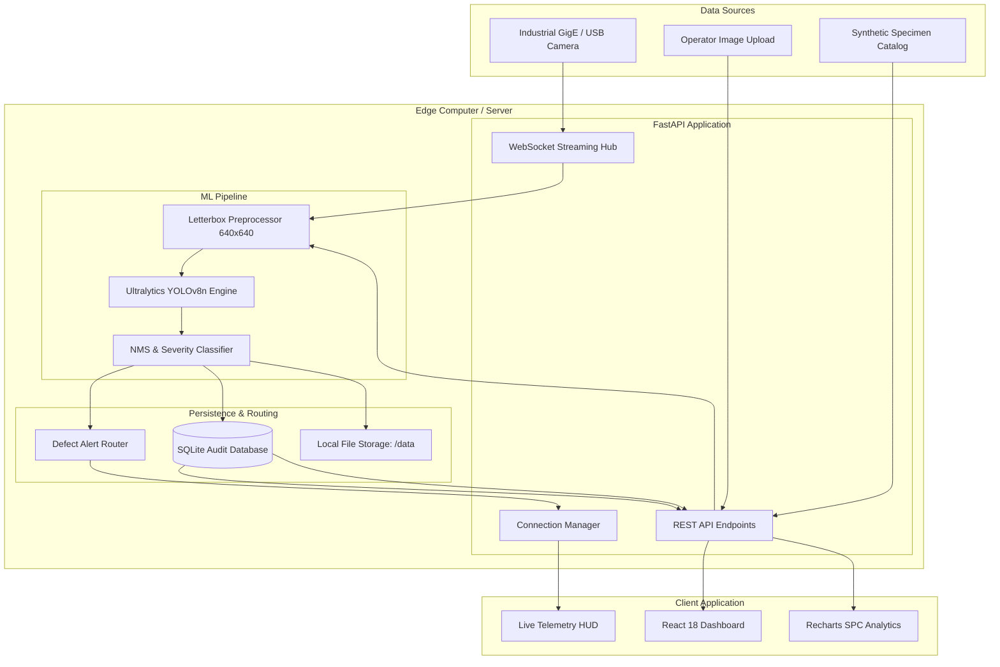
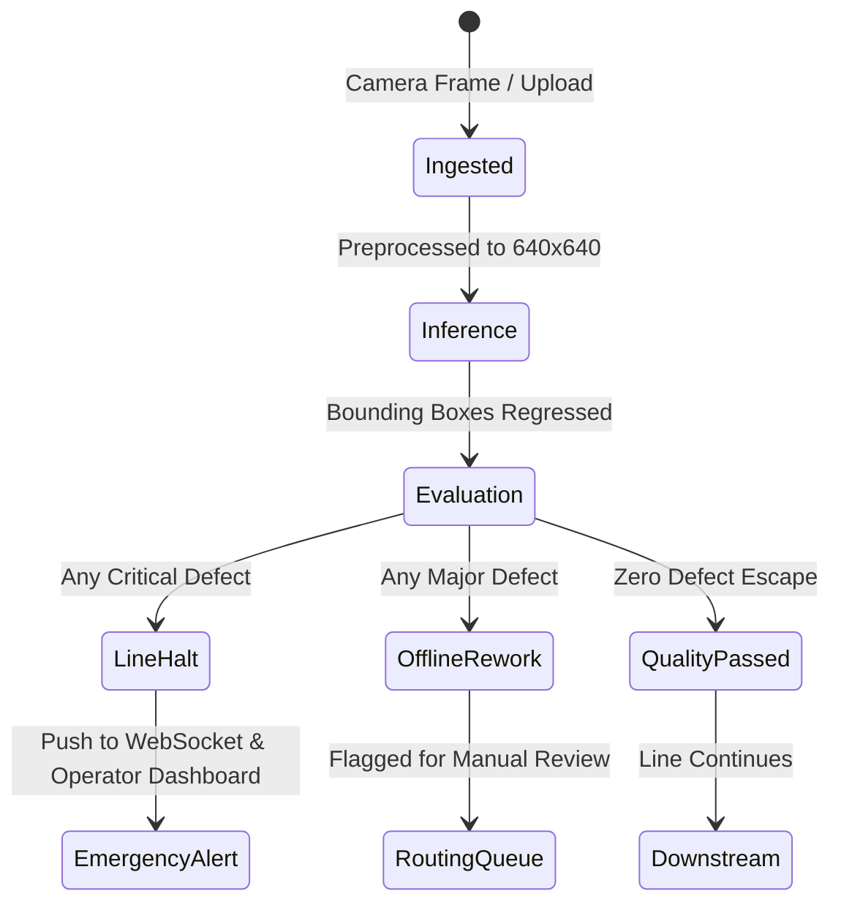

# VisionGuard QA — Architecture & Design Document

---

## 1. System Overview

VisionGuard QA is designed as an edge-native, automated visual inspection platform for modern manufacturing environments. The system balances inference throughput with classification accuracy, offering high uptime without requiring dedicated GPU server farms.

---

## 2. ML Inference Pipeline

### 2.1 Letterboxing & Preprocessing
Industrial camera inputs arrive with arbitrary resolutions and aspect ratios. The `ImagePreprocessor` implements aspect-ratio-preserving letterboxing:
1. Calculates uniform scaling factor: $s = \min(640 / w_{orig}, 640 / h_{orig})$.
2. Scales image using bilinear interpolation.
3. Centers the scaled image onto a neutral gray `(114, 114, 114)` canvas.
4. Preserves original dimensions $(H, W)$ to re-map defect coordinates accurately to full-resolution images.

### 2.2 Severity Classification Logic
Defect severity is calculated deterministically to eliminate false-alarm line halts while catching catastrophic flaws:

$$\text{Severity} = \begin{cases} 
\text{Critical} & \text{if } \text{confidence} \ge 0.80 \text{ and } \text{area\_ratio} \ge 0.05 \\
\text{Major} & \text{if } \text{confidence} \ge 0.55 \\
\text{Minor} & \text{otherwise (above threshold } 0.35\text{)}
\end{cases}$$

### 2.3 Manufacturing Route Dispatch State Machine

---

## 3. Storage & Persistence Schema

### 3.1 Tables
- **`inspections`**: Master audit record for every analyzed frame or file, including overall outcome (`passed`, `flagged`, `rejected`), latency metrics, and paths to both original and annotated images.
- **`defects`**: Normalized 1-to-many relationship with `inspections`. Stores exact bounding box coordinates $(x_1, y_1, x_2, y_2)$, defect classification name, area ratio, and model confidence.
- **`alerts`**: Actionable manufacturing events. Maintains operator acknowledgment state, timestamp, and audit trail.

---

## 4. Hardware & Deployment Feasibility

VisionGuard QA was engineered specifically to be runnable by small and medium-sized manufacturers (SMEs):
- **CPU**: Standard x86-64 multi-core processor (Intel Core i5 / AMD Ryzen 5 or higher).
- **RAM**: Minimum 4GB (8GB recommended).
- **GPU**: Optional (CUDA automatic detection supported).
- **Storage**: ~500MB for application, dependencies, and model weights.
- **Network**: Self-contained edge operation; zero cloud or internet connectivity needed during live manufacturing line operation.

